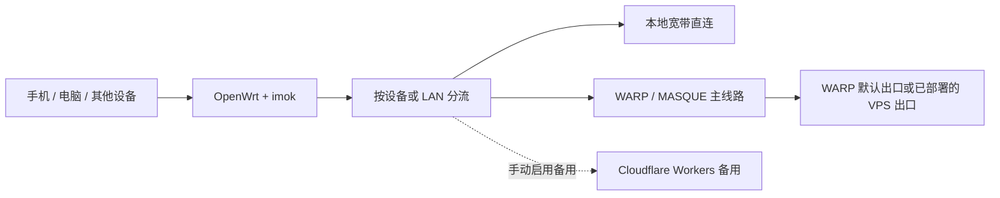

# imok · OpenWrt WARP / MASQUE 路由器分流

**在路由器上统一管理 Cloudflare WARP、设备分流和 DNS，让需要代理的流量走指定出口，让直连流量继续走本地宽带。**

OpenWrt / LuCI policy-based routing with **Cloudflare WARP (MASQUE)**, per-device / LAN rules, DNS diagnostics and a manually enabled Cloudflare Workers backup.

[下载更名版 v0.2.33-1](https://github.com/routepilot-lab/imok/releases/tag/v0.2.33-1) · [安装说明](packages/luci-app-routepilot/INSTALL.zh-CN.md) · [中文使用指南](packages/luci-app-routepilot/README.zh-CN.md) · [常见问题](docs/FAQ.md) · [反馈问题](https://github.com/routepilot-lab/imok/issues/new/choose)

## 它解决什么问题？

- **多台设备不想逐个配置。** 在兼容路由器上按设备或整个 LAN 选择接管范围，让接入网络的手机、电脑等设备共用路由器策略。
- **不希望所有流量都走同一条路径。** 可选国内 IP 直连、全部代理、代理名单、直连名单等模式；设备和网络范围由你决定。
- **有 WARP、Zero Trust 或 VPS，但管理分散。** 在 LuCI 中集中查看账户、协议、入口、已部署的虚拟网络出口和当前运行状态。
- **连不上时不知道问题在哪。** 独立查看 DNS、网站连通性、实际出口 IP / 地区、连接记录和流量观测，区分“已保存”和“已生效”。

适合已有 Cloudflare 账户、兼容 OpenWrt 环境，并愿意自行管理网络线路的用户。**当前是测试版，首次部署仍需要准备运行环境，并非上传一个 IPK 就能在全新路由器上使用。**

## 核心特点

| 能力 | 对使用者的价值 |
| --- | --- |
| WARP / MASQUE 主线路 | 在路由器统一管理官方客户端连接与账户出口 |
| 按设备或 LAN 分流 | 自行决定哪些设备 / 网络接管，以及直连或代理规则 |
| 入口与出口分开管理 | 入口支持官方自动、固定候选、手写 IPv4；出口从账户已有虚拟网络中选择 |
| 入口应用后检测 | 短暂重连并验证原预期出口；失败尝试恢复，无法确认时保留阻断与恢复证据 |
| 独立 DNS 管理 | 国内与代理上游、缓存状态、清缓存和解析检测，定位解析问题 |
| 手动 Workers 备用 | 部署、域名绑定、PROXYIP、优选、独立检测和启用分别操作，切换由你决定 |
| 五个独立设置页 | 账户与协议、出口与分流、设备、DNS、Workers 按页读取数据 |
| 保留既有配置 | 不改写原 SSR、系统 network/firewall/dhcp 配置；开关和接管范围明确 |

普通主线路故障时，当前策略会撤回接管并可能允许宽带直连；入口恢复无法确认时另有阻断保护。请按自己的需求理解这些行为。

## 一张图看懂线路



**入口 IP 不等于出口 IP。** 优选或固定入口影响连接 Cloudflare 的路径；实际网站看到哪个出口，取决于当前 WARP / 虚拟网络 / VPS 或备用线路。出口名称也不等于地区证明，可在页面检测实际出口。

## 更名与升级兼容

项目原名 **RoutePilot**，现更名为 **imok**。为了让已有用户保留注册身份与现有设置，安装包仍叫 `luci-app-routepilot`；UCI 配置、服务名、命令、目录和备份格式继续沿用 `routepilot`。这些技术标识不是漏改，无需卸载旧包或重装运行环境。LuCI 的菜单与品牌显示改为 imok。仓库地址现为 `routepilot-lab/imok`，历史版本保留。

## 开始使用

1. **确认环境。** 本轮已验证 GL.iNet GL-MT6000、ARM64、OpenWrt 24.10。其他硬件 / 固件请先核对兼容性。
2. **阅读安装说明。** [Release](https://github.com/routepilot-lab/imok/releases/tag/v0.2.33-1) 提供插件 IPK、公开源码和 SHA256SUMS。已有兼容运行环境可备份后升级插件；新设备需另行合法准备未注册运行环境和固件依赖。
3. **授权自己的账户。** 在“账户与协议”完成路由器登录；在“出口与分流”选择账户已有出口与接管范围。VPS 出口需事先在组织端部署对应路由。
4. **手动开启并验证。** 查看总览实际状态，到 DNS 页检测解析与网站连通性；需要时再配置、独立测试和手动启用 Workers 备用。

公开包不包含 Cloudflare 客户端、Debian 运行环境、账户身份、API 令牌或私人节点。首次安装默认关闭；已有设备升级保留设置和身份，但会短暂重连。

## 当前版本和验证范围

**v0.2.33-1 · imok 更名版（预发布）。**

2026-11-06：维护者反馈，原 v0.2.32-2 连续日常使用数日，未发现问题。本次更名版只调整品牌显示、版本和文档，保留网络逻辑及配置兼容；该使用反馈属于原版本的实际体验，不表示新包已经在所有设备或环境完成验收。

**部署进展：** 2026-11-06，imok v0.2.33-1 已安装到维护者的现有路由器。安装时核对了 40 项程序文件，配置、注册身份、入口方式和原出口保持，连续运行状态及代理 / 直连 HTTPS 检查通过。2026-11-08，维护者再次反馈“没问题了”。详见[更名版安装记录](docs/validation/2026-11-06-imok-install.json)及[使用反馈](docs/USER_FEEDBACK.md)。

下列原版本验收与更名版的本地回归记录继续保留：

- 331 项 Python 测试、7 组 JavaScript、目标 LuCI 契约、资源/权限校验及可重复构建通过。
- 现有目标设备核对 40 项程序文件，配置、身份、原入口及出口保持；连续状态、代理与直连 HTTPS 检查通过。
- Safari 已检查五个独立页面；Opus 参与独立静态审查。

[验证摘要](docs/PUBLICATION_CHECKS.json)记录具体范围。长期稳定性、手机速度、其他机型、新设备完整安装、WireGuard 切换、多 LAN 真实设备和入口故障注入尚未在本轮验收。Workers 备用仅支持 IPv4 TCP，需手动启用，不自动故障切换；本项目不承诺固定带宽、任意地区或全网最优入口。

## English overview

imok is an **OpenWrt LuCI routing plugin** for managing a Cloudflare WARP / MASQUE primary connection, per-device or LAN-wide split tunneling, DNS upstreams and diagnostics, and a manual Cloudflare Workers backup.

Use it to centralize routing rules on a compatible router, choose which devices or networks are managed, keep selected traffic direct, and inspect the active connection and exit. Existing account virtual networks can be selected; a VPS exit requires routes already deployed in your Cloudflare organization. Changing a Cloudflare entry IP does not select an exit country.

The current release is **the imok rebranding pre-release (v0.2.33-1)**. The maintainer reports several days of daily use of the previous v0.2.32-2 without observed issues; this is user-reported experience, not a universal stability guarantee. The rebranding package was installed on the maintainer's GL-MT6000 / ARM64 OpenWrt 24.10 router on November 6, 2026. Installation checks confirmed matching program files, preserved configuration and identity, unchanged entry settings and exit, and successful connection checks. The maintainer reported no issues again on November 8. See the deployment record and user feedback; these observations do not extend the tested hardware or network coverage. The IPK updates an existing compatible runtime; it is not a complete first-install bundle. Runtime software, Cloudflare credentials and private configurations are not distributed. Workers backup supports IPv4 TCP and must be tested and enabled manually. See [installation](packages/luci-app-routepilot/INSTALL.zh-CN.md), [FAQ](docs/FAQ.md) and [releases](https://github.com/routepilot-lab/imok/releases).

## 反馈与参与

遇到问题请通过 [Issues](https://github.com/routepilot-lab/imok/issues/new/choose) 提交版本、硬件、固件、复现步骤及脱敏后的错误信息。欢迎补充兼容设备的实际体验、完善文档或提交修复；请勿上传令牌、登录链接、私钥或完整设备配置。

如果项目对你有帮助，欢迎 Star，或把仓库分享给有相同 OpenWrt / WARP 管理需求的人。

## 构建与检查

```sh
python3 packages/luci-app-routepilot/tools/asset_versions.py --check
python3 packages/luci-app-routepilot/tools/build.py
python3 packages/luci-app-routepilot/tools/check_all.py --luci-core /path/to/target/luci.js --report .local/check-all/report.json
```

Makefile 为版本唯一来源；测试使用 Python / Node 标准库。完整检查需自行取得目标 LuCI 核心文件，不用替身冒充真实 ABI 验收。

## 项目初衷与感谢 / Acknowledgements

imok 从一个真实的需求开始：让大陆用户在兼容路由器上，更方便地管理访问开放互联网的连接，同时兼顾日常直连、速度体验和可控性。项目由维护者持续提出需求、亲自试用和反馈，并与 AI 工具一起反复开发、检查与改进，逐步走到公开发布。我们希望这些工作能帮助更多有相同需求的人。

首先感谢 **[Cloudflare](https://www.cloudflare.com/)**。WARP、Zero Trust 和 Workers 为这个项目提供了关键的服务与技术基础；imok 在这些能力之上，把路由器侧的管理、分流和诊断整理为可操作的界面。

感谢 **[ChatGPT / OpenAI](https://openai.com/chatgpt/)**，在需求梳理、技术研究、代码开发、测试、排障和文档整理中参与协作，让一个想法逐步成为可以使用、检查和分享的项目。

感谢 **[Claude Opus / Anthropic](https://www.anthropic.com/claude)**，在关键方案与代码差异的独立技术审查中提供另一份判断，帮助我们发现遗漏、核对边界并改进实现。独立静态审查与实际运行验证各有职责，相关验证范围记录在项目文档中。

也感谢 **OpenWrt、LuCI、cmliu/edgetunnel 及相关开源贡献者**，以及每一位愿意试用、反馈和完善项目的人。项目的进步来自这些基础与协作，也来自维护者坚持把真实问题一个个解决。

我们对更广泛可用性的期待是项目愿景；实际速度和可用性仍取决于运营商、网络环境、Cloudflare 服务、所选出口及硬件，不能将当前测试结果视为对所有地区、所有用户或固定带宽的保证。

**English:** Our thanks go first to Cloudflare for the WARP, Zero Trust and Workers foundations; to ChatGPT / OpenAI for development collaboration; to Claude Opus / Anthropic for independent technical review; and to the OpenWrt, LuCI and upstream open-source communities. imok is a community project, independently maintained and not an official product or endorsement of these organizations.

## 许可

imok 自有代码为 MIT，内置 cmliu/edgetunnel 衍生 Worker 为 GPL-2.0，保留对应源码、许可及来源。第三方客户端和服务按各自条款使用。参见[第三方说明](THIRD_PARTY_NOTICES.txt)。本项目不是 Cloudflare 官方产品。
