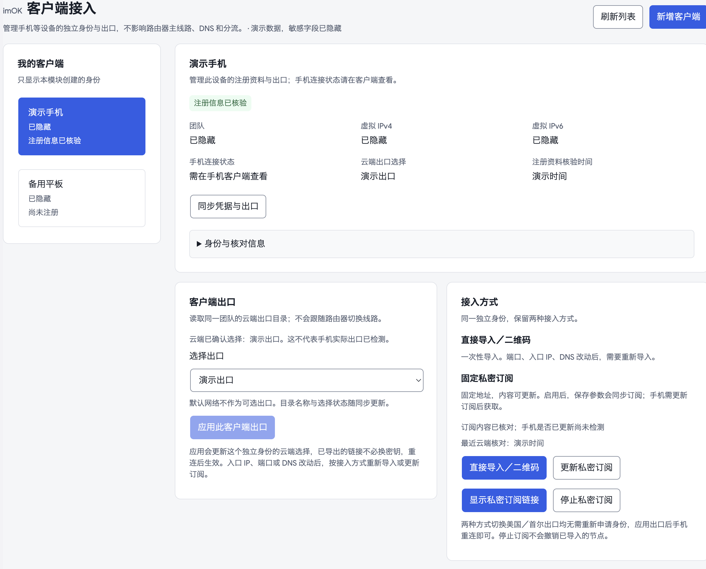
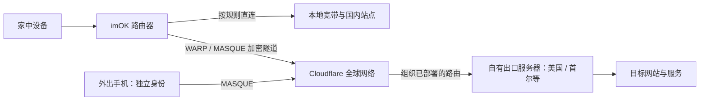

# imOK 2.0

> **v0.2.37-1 预发布：WARP 安装与更新。** 自动检测环境、从官方来源准备文件；默认每日检查新版，安装与升级单独确认。现有环境的插件更新和版本检查已实测，全新 WARP 安装／升级／恢复仍待实机验收。[使用说明](docs/WARP_RUNTIME.md)。

### 借助 Cloudflare 全球网络，让路由器和手机的接入更灵活、全球出口更可控。

**imOK 是面向 OpenWrt / LuCI 的开源网络管理插件。** 它把 Cloudflare WARP / MASQUE、已有云端出口、设备分流、DNS、规则更新和手机独立接入，整合成一个清晰的控制台。

家里的设备按需分流，外出的手机使用独立身份；入口、端口和出口分别管理，配置变化看得明白，遇到问题也有状态和诊断可查。

[**下载 v0.2.37-1 预发布**](https://github.com/routepilot-lab/imok/releases/tag/v0.2.37-1) · [v0.2.36-1 正式版](https://github.com/routepilot-lab/imok/releases/tag/v0.2.36-1) · [安装与升级](packages/luci-app-routepilot/INSTALL.zh-CN.md) · [手机接入](docs/CLIENT_ACCESS.md) · [常见问题](docs/FAQ.md) · [更新记录](CHANGELOG.md)

**Cloudflare WARP / MASQUE management for OpenWrt:** per-device and LAN routing, independent mobile identities, private subscriptions, DNS diagnostics and persistent personal rules.

## 为什么做 imOK？

Cloudflare 提供了全球网络和加密隧道，但把“路由器怎么接、哪些设备走代理、手机用哪个出口、规则怎么更新”整理成日常可用的系统，仍有不少工作。

imOK 负责把这些工作变得集中、清楚、可控。**不是再给你一堆节点，而是把自己已有的网络资源用起来。**

- **第一次使用知道先做什么。** 独立的 WARP 安装与更新入口，自动识别受支持环境、准备官方组件，下载与确认安装分开；已有环境无需重装。
- **持续维护更清楚。** 默认每天检查 WARP 版本，发现新版提示，不自动升级；维护有明确确认、校验和恢复副本。
- **借助 Cloudflare 的连接路径。** 本地先接入 Cloudflare，再按组织路由到达已部署出口，减少对本地直连某台 VPS 的依赖；在合适的网络条件下，有机会改善跨网访问体验。
- **家里一次配置，选定设备共同使用。** 可按设备或 LAN 接管；国内直连、全部代理、代理名单等策略各有适用范围。
- **家里和手机可以分别管理。** 手机使用独立 MASQUE 身份、地址与出口选择，不复制路由器私钥，也不要求路由器跟着手机换线。
- **一个私密订阅地址，持续更新参数。** 在 imOK 保存入口 IP、端口或 DNS 后同步订阅；手机更新订阅即可获取，无需每次传新链接。直接导入和二维码也保留。
- **入口灵活，出口明确。** 入口决定如何连到 Cloudflare；出口决定从哪里访问网站。可使用账户中已部署的美国、首尔等出口，地区以实际观测为准。
- **规则更新不冲掉个人选择。** 可编辑来源与更新频率，搜索规则、添加个人条目、长期排除不需要的条目，订阅更新保留个人覆盖。
- **连接情况说清楚。** 已保存、已应用、隧道连接、网站检测、手机连接是不同状态，避免一个绿色“正常”掩盖问题。
- **复杂功能也能找到。** 统一的 14 个页面、清晰分组、可见选中状态、桌面优先排版，以及独立的 Workers 手动备用。

实际速度取决于本地运营商、Cloudflare 路径、出口服务器和目标站点；项目不提供免费节点、固定带宽或“永不掉线”的保证。

## 先看效果

**总览：连接、接管范围、代理 / 直连流量、上传下载与七日趋势。**


**客户端接入：独立身份、云端出口、直接导入与固定私密订阅。**



截图运行真实前端，只使用隔离演示数据；IP、租户与身份标识已隐藏，不含维护者真实配置，也不代表测速结果。

## 原理：入口和出口分开

可以把 Cloudflare 理解为中间的网络枢纽：**你先连到它，再由已经配置好的云端路由把流量送到自己的出口。** 下面是使用自有出口服务器时的简化路径：



imOK 管理路由器侧的接入、策略和状态，并为独立手机身份选择已有出口。**云端出口与组织路由需要事先部署**，插件不会自动购买 VPS、创建全球节点，也不是任意国家解锁器。一个路由器主客户端同时共用一个出口；独立手机身份可另行选择。

### VPS 的公网 IP 直连受限，还能用吗？

**在适用条件下，有可能继续使用。** 客户端不必直接连接 VPS 公网 IP，而是先连接 Cloudflare；云端节点也连接到 Cloudflare，流量经组织路由到达该节点。

因此，如果受限的是“你本地 → VPS 公网 IP”的直连路径，而两端到 Cloudflare 的连接、组织路由及 VPS 出网都正常，这条间接路径仍可能可用。这是网络拓扑的优势推论，不是本项目提供的抗封锁保证。

如果目标网站拒绝的是 **VPS 出口 IP**，网站仍可能拒绝；VPS 停机、出网受限或 Cloudflare 路径不可用时，也会受影响。入口 IP 不能代替出口 IP，换端口也不等于换地区。

原理参考：[Cloudflare One 加密接入](https://developers.cloudflare.com/cloudflare-one/team-and-resources/devices/cloudflare-one-client/)、[Mesh 连接模型](https://developers.cloudflare.com/mesh/concepts/)、[节点路由与公网出口](https://developers.cloudflare.com/mesh/features/routes/)。这是连接模型说明，imOK 当前没有完整 Mesh 管理控制台。

## 六个主入口，十四个页面

| 主入口 | 能力 |
| --- | --- |
| 总览 | 开关、当前连接与出口、接管范围、流量、七日趋势、诊断详情 |
| WARP 安装与更新 | 环境检测、官方组件准备、每日检查、新版提示、明确确认后的维护与恢复副本；运行环境写入仍待独立实机验收 |
| Cloudflare 配置中心 | 账户与协议、主线路入口、出口与分流、设备、DNS、Workers 六页 |
| 客户端接入 | 独立手机注册、凭据同步、出口选择、可选端口 / DNS、直接导入、私密订阅、撤销与删除 |
| 规则与更新 | 更新概况、来源与频率、规则管理、自定义分流四页 |
| 备份迁移 | 设置导出 / 导入，保留 v2 / v3 格式兼容 |

Workers 保留授权、域名 / 项目选择、部署、证书、PROXYIP、入口优选与独立检测；当前是 **IPv4 TCP 手动备用**，不会自动故障切换。imOK 字体继承 Argon，样式限定在插件内，不修改其他 LuCI 页面。

## 下载和安装

当前预发布：**v0.2.37-1 · WARP 安装与更新**；保留 v0.2.36-1 正式版。`2.0` 表示界面体系，安装包沿用原有版本规则与 `luci-app-routepilot` 包名，保留旧配置兼容。

[前往预发布下载](https://github.com/routepilot-lab/imok/releases/tag/v0.2.37-1)：

| 文件 | 用途 |
| --- | --- |
| `imOK-0.2.37-1-install-kit.zip` | 适合下载保存或网盘分享：完整插件 IPK、源码、安装说明、版本说明与内部校验文件 |
| `luci-app-routepilot_0.2.37-1_all.ipk` | 已有兼容运行环境的完整插件安装 / 升级包，含本版全部功能，不是增量补丁 |
| `imOK-0.2.37-1-public-source.zip` | 公开源码、测试、文档与许可 |
| `SHA256SUMS` | 上述安装、源码与分享包的校验值 |

**新设备先读安装说明。** 公开分享包不是路由器固件，不含第三方 WARP 客户端 / Debian 运行环境、账户、私钥或任何现成节点。先安装插件，在“WARP 安装与更新”检测环境；本版提供受支持平台的官方组件自动准备实验流程，首次安装仍待独立实机验收。已有环境只升级 IPK，先备份并准备独立管理连接，升级可能短暂重连。不要卸载、重注册或覆盖运行环境来完成普通升级。

已验证现场：**GL.iNet GL-MT6000 / ARM64 / OpenWrt 24.10 / Argon 2.2.9.4**。其他机型、架构与全新环境需自行验证，不因为 IPK 标为 `all` 就代表任意设备都可直接安装。

## 本版做了哪些验证？

- 主 Python 521 项、服务端 5 项、18 组前端、目标 LuCI 契约、资源哈希与可复现构建通过；发布保护 11 项测试单独运行。
- 新 WARP 页面在 1440 / 768 / 375 / 320 隔离预览检查；真实桌面 Argon 检查总览、WARP 页面、导航与按钮，实际提交版本检查并得到新结果。
- 现有路由器的进程、出口设置、配置、身份和 WARP 二进制保留；90 次连续采样、更新前后的代理与直连 HTTPS 检查通过。
- 维护者采用受控文件更新保留当前连接。**普通 IPK 安装可能短暂重连；本次没有在生产设备重新执行该升级钩子。**

全新 WARP 安装、APT 升级和运行环境恢复没有完成独立实机验收，本版因此使用预发布标记。热更新后，新增启动保护在下次正常启动插件时加载；维护前应准备独立本地管理连接。其他系统、浏览器、组织策略及长期负载仍有验证边界。详见[公开检查摘要](docs/PUBLICATION_CHECKS.json)与[验证和回滚说明](docs/quality/warp-maintenance-0.2.37-1.md)。

主线路故障撤回接管时可能使用宽带直连；本插件不提供 IPv6 代理，可阻断 IPv6 或明确允许其直连。普通“导出配置”不包含客户端私钥、手机订阅、个人规则覆盖及第三方授权，迁移前请阅读说明。

## 开发、反馈与支持

原生 LuCI JavaScript + Python + UCI，无 React / Vue，也没有新增远程字体。构建与检查：

```sh
python3 packages/luci-app-routepilot/tools/asset_versions.py --check
python3 packages/luci-app-routepilot/tools/build.py
python3 packages/luci-app-routepilot/tools/check_all.py --luci-core /path/to/target/luci.js --report .local/check-all/report.json
```

遇到问题，请在 [Issues](https://github.com/routepilot-lab/imok/issues) 提供版本、设备、复现步骤和脱敏错误；不要上传私钥、Token、授权链接或完整配置。**如果 imOK 让你的网络更省心，欢迎点一个 Star，或分享给有同样需求的人。** 实际使用反馈比未经验证的速度宣传更能帮助项目成长。

## English overview

imOK brings Cloudflare WARP / MASQUE, existing organization egress routes, per-device / LAN policies, DNS diagnostics and independent mobile profiles into one OpenWrt / LuCI console. Mobile profiles support direct import, offline QR and fixed private subscriptions. Entry selection, configured egress and observed connectivity remain separate.

**v0.2.37-1 is a pre-release** adding official runtime preparation and scheduled version checks. Existing-runtime plugin updates and metadata checks were verified on ARM64 OpenWrt 24.10; fresh WARP installation, APT upgrades and runtime recovery still need independent hardware testing. v0.2.36-1 remains available as the stable release. Downloads include the plugin, public source and a shareable installation kit; your own authorization is required; this is not firmware or a bundled WARP runtime. Cloudflare-based routing can reduce reliance on the direct client-to-VPS path, but does not guarantee speed, availability, anonymity or acceptance of the VPS egress IP by destination services.

## 致谢与许可

感谢 [Cloudflare](https://www.cloudflare.com/) 提供网络与服务基础，感谢 OpenWrt、LuCI、cmliu/edgetunnel、usque、二维码库及开源贡献者。项目由维护者持续试用、反馈，并借助 ChatGPT / OpenAI 开发协作与既往 Claude Opus 独立审查逐步完善。

自有代码 MIT；内置 cmliu/edgetunnel 衍生 Worker 为 GPL-2.0，保留对应源码与许可。第三方客户端与服务遵守各自条款，参见[第三方说明](THIRD_PARTY_NOTICES.txt)。本项目独立维护，不是 Cloudflare 官方产品。
