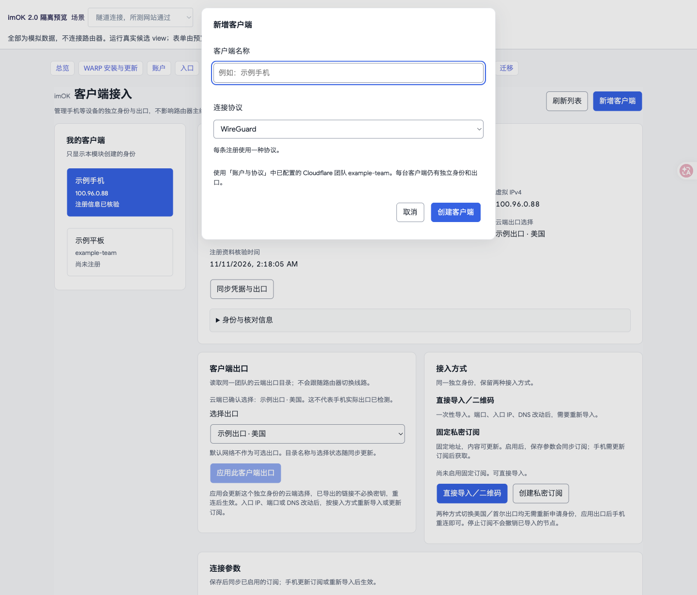
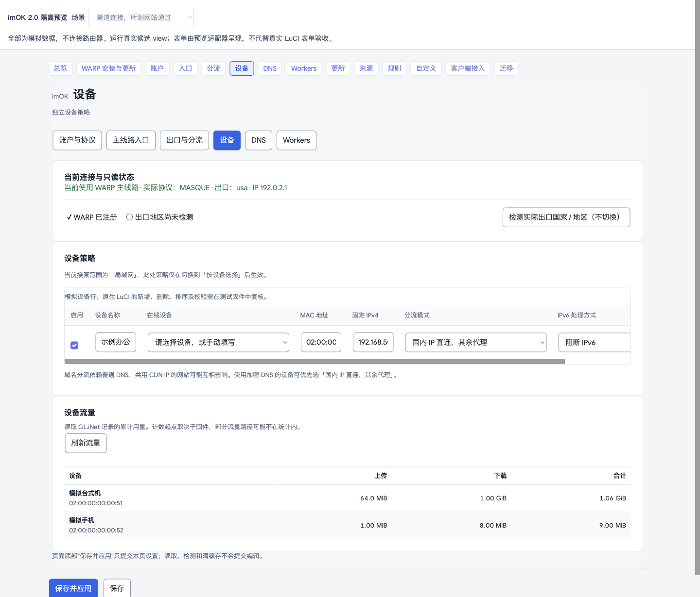
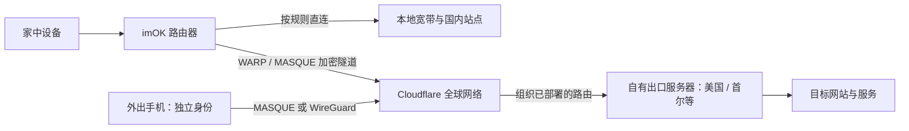

# imOK · Cloudflare 分流助手

> **最新正式版 v0.2.37-5**。总览减少重复重绘，安装包构建不再回写源码。包含独立客户端双协议、按客户端选出口和局域网设备流量统计。[本版更新](docs/releases/v0.2.37-5.md)

> **预发布 v0.2.38-17**。路由器在后台自动检测联网并更新总览，同时包含 DNS、测速与恢复修复。[预发布说明](docs/releases/v0.2.38-17.md) · [下载](https://github.com/routepilot-lab/imok/releases)

## 使用前提

准备自己的 Cloudflare Zero Trust 团队及已部署出口。已验证平台为 GL.iNet GL-MT6000、ARM64、OpenWrt 24.10。全新设备及其他架构请先核对[已知限制](docs/KNOWN_LIMITS.md)和[实机验收清单](docs/HARDWARE_ACCEPTANCE.md)。

### 借助 Cloudflare 全球网络，让路由器和手机的接入更灵活、全球出口更可控。

**imOK 是面向 OpenWrt / LuCI 的开源分流助手。** 它把 Cloudflare WARP / MASQUE、已有云端出口、设备分流、DNS、规则更新和手机独立接入，整合成一个清晰的控制台。

我用 Codex 和 Claude 一起开发 imOK，想把家里设备怎么分流、外出的手机走哪个出口，放到同一个路由器后台管理。

[**下载 v0.2.37-5 正式版**](https://github.com/routepilot-lab/imok/releases/tag/v0.2.37-5) · [历史版本](https://github.com/routepilot-lab/imok/releases) · [安装与升级](packages/luci-app-routepilot/INSTALL.zh-CN.md) · [手机接入](docs/CLIENT_ACCESS.md) · [常见问题](docs/FAQ.md) · [更新记录](CHANGELOG.md)

**Cloudflare WARP management for OpenWrt:** independent MASQUE and WireGuard clients, per-client egress selection, LAN device usage, private subscriptions, DNS diagnostics and persistent personal rules.

## 为什么做 imOK？

Cloudflare 提供了全球网络和加密隧道，但把“路由器怎么接、哪些设备走代理、手机用哪个出口、规则怎么更新”整理成日常可用的系统，仍有不少工作。

imOK 把入口、出口、规则和客户端放到一个页面体系里，方便配置自己的网络资源和排查连接问题。

- **第一次使用知道先做什么。** 独立的 WARP 安装与更新入口，自动识别受支持环境、准备官方组件，下载与确认安装分开；已有环境无需重装。
- **持续维护更清楚。** 默认每天检查 WARP 版本，发现新版提示，不自动升级；维护有明确确认、校验和恢复副本。
- **借助 Cloudflare 的连接路径。** 本地先接入 Cloudflare，再按组织路由到达已部署出口，减少对本地直连某台 VPS 的依赖；在合适的网络条件下，有机会改善跨网访问体验。
- **入口灵活，出口明确。** 入口决定如何连到 Cloudflare；出口决定从哪里访问网站。可使用账户中已部署的美国、首尔等出口，地区以实际观测为准。
- **规则更新不冲掉个人选择。** 可编辑来源与更新频率，搜索规则、添加个人条目、长期排除不需要的条目，订阅更新保留个人覆盖。
- **连接情况说清楚。** 已保存、已应用、隧道连接、网站检测、手机连接是不同状态，避免一个绿色“正常”掩盖问题。
- **复杂功能也能找到。** 统一的 14 个页面、清晰分组、可见选中状态、桌面优先排版，以及独立的 Workers 手动备用。

实际速度取决于本地运营商、Cloudflare 路径、出口服务器和目标站点；项目不提供免费节点、固定带宽或“永不掉线”的保证。

## 家里的设备按台分流，独立客户端各选出口

**家里最多同时启用 8 台设备的分流策略。** 比如 Mac mini 用「全部代理」，另一台电脑用「国内 IP 直连，其余代理」，电视继续走原来的网络。也可以用域名名单选择哪些网站走代理。选中在线设备即可带入 MAC 和 IPv4。受管设备可以使用不同规则，代理流量共用路由器当前选择的出口。想让整个局域网使用统一策略，也可以切换接管范围。

**一台 imOK 路由器最多管理 32 条独立客户端配置。** 实际可注册数量取决于 Cloudflare 团队的权限和配额。每条客户端记录在创建时独立选择 MASQUE 或 WireGuard，使用同一 Cloudflare 团队内各自独立的注册身份。协议决定怎么连接，出口决定从哪里访问网站，可从团队已部署的出口中逐台选择。例如路由器保持原出口，一部手机用 WireGuard 走首尔，另一部用 MASQUE 走美国。给其中一部换出口后，只需让那部手机重连。

**入口、端口和 DNS 也可以逐台设置。** MASQUE 可直接导入、扫码或添加固定私密订阅；WireGuard 可扫码、下载或复制配置。以后调整入口 IP、端口或 DNS，直接导入的设备需重新导入；使用 MASQUE 订阅的设备刷新订阅后重连。停用旧设备时可以单独撤销它的身份。[客户端接入说明](docs/CLIENT_ACCESS.md)

**「设备」页可查看每台局域网设备的流量。** 支持的 GL.iNet 固件会提供累计上传、下载和合计数据，计数起点与覆盖范围由固件决定。路由器外的独立客户端不计入此表。

## 先看效果

**总览：连接、接管范围、代理 / 直连流量、上传下载与七日趋势。**


**客户端接入：创建时选协议，注册后为这条身份单独选出口。**



**设备流量：每台局域网设备的上传、下载和合计。**



截图只使用隔离演示数据，所示设备、团队、地址和用量均为示例，不含真实配置。

## 原理：入口和出口分开

可以把 Cloudflare 理解为中间的网络枢纽：**你先连到它，再由已经配置好的云端路由把流量送到自己的出口。** 下面是使用自有出口服务器时的简化路径：



imOK 管理路由器侧的接入、策略和状态，并为独立手机身份选择已有出口。**云端出口与组织路由需要事先部署**，插件不会自动购买 VPS、创建全球节点，也不是任意国家解锁器。一个路由器主客户端同时共用一个出口；独立手机身份可另行选择。

### VPS 的公网 IP 直连受限，还能用吗？

**在适用条件下，有可能继续使用。** 客户端不必直接连接 VPS 公网 IP，而是先连接 Cloudflare；云端节点也连接到 Cloudflare，流量经组织路由到达该节点。

因此，如果受限的是“你本地 → VPS 公网 IP”的直连路径，而两端到 Cloudflare 的连接、组织路由及 VPS 出网都正常，这条间接路径仍可能可用。这是网络拓扑的优势推论，不是本项目提供的抗封锁保证。

如果目标网站拒绝的是 **VPS 出口 IP**，网站仍可能拒绝；VPS 停机、出网受限或 Cloudflare 路径不可用时，也会受影响。入口 IP 不能代替出口 IP，换端口也不等于换地区。

原理参考：[Cloudflare One 加密接入](https://developers.cloudflare.com/cloudflare-one/team-and-resources/devices/cloudflare-one-client/)、[Mesh 连接模型](https://developers.cloudflare.com/mesh/concepts/)、[节点路由与公网出口](https://developers.cloudflare.com/mesh/features/routes/)。这是连接模型说明，imOK 当前没有完整 Mesh 管理控制台。

## 六个主入口，十四个页面

| 主入口 | 能力 |
| --- | --- |
| 总览 | 开关、当前连接与出口、接管范围、流量、七日趋势、诊断详情 |
| WARP 安装与更新 | 环境检测、官方组件准备、每日检查、新版提示、明确确认后的维护与恢复副本；运行环境写入仍待独立实机验收 |
| Cloudflare 配置中心 | 账户与协议、主线路入口、出口与分流、设备策略与流量、DNS、Workers 六页 |
| 客户端接入 | 独立 MASQUE / WireGuard 注册、团队服务授权、逐客户端选出口、端口 / DNS、扫码或配置导入、MASQUE 私密订阅、撤销与删除 |
| 规则与更新 | 更新概况、来源与频率、规则管理、自定义分流四页 |
| 备份迁移 | 设置导出 / 导入，保留 v2 / v3 格式兼容 |

Workers 保留授权、域名 / 项目选择、部署、证书、PROXYIP、入口优选与独立检测；当前是 **IPv4 TCP 手动备用**，不会自动故障切换。imOK 字体继承 Argon，样式限定在插件内，不修改其他 LuCI 页面。

## 下载和安装

当前正式版为 **v0.2.37-5 · 收尾优化版**。历史版本仍可在 Releases 下载。`2.0` 表示界面体系，安装包沿用原有版本规则与 `luci-app-routepilot` 包名，保留旧配置兼容。

[前往正式版下载](https://github.com/routepilot-lab/imok/releases/tag/v0.2.37-5)：

| 文件 | 用途 |
| --- | --- |
| `imOK-0.2.37-5-install-kit.zip` | 适合下载保存或网盘分享：完整插件 IPK、源码、安装说明、版本说明与内部校验文件 |
| `luci-app-routepilot_0.2.37-5_all.ipk` | 已有兼容运行环境的完整插件安装 / 升级包，含本版全部功能，不是增量补丁 |
| `imOK-0.2.37-5-public-source.zip` | 公开源码、测试、文档与许可 |
| `SHA256SUMS` | 上述安装、源码与分享包的校验值 |

**新设备先读安装说明。** 公开分享包不是路由器固件，不含第三方 WARP 客户端 / Debian 运行环境、账户、私钥或任何现成节点。先安装插件，在“WARP 安装与更新”检测环境；本版提供受支持平台的官方组件自动准备实验流程，首次安装仍待独立实机验收。已有环境只升级 IPK，先备份并准备独立管理连接，升级可能短暂重连。不要卸载、重注册或覆盖运行环境来完成普通升级。

已验证现场：**GL.iNet GL-MT6000 / ARM64 / OpenWrt 24.10 / Argon 2.2.9.4**。其他机型、架构与全新环境需自行验证，不因为 IPK 标为 `all` 就代表任意设备都可直接安装。

## 本版做了哪些验证？

- 插件与服务端回归、前端检查、目标 LuCI 契约、资源哈希、可重复构建和发布保护测试通过。
- 本版总览通过隔离浏览器验证，流量数据不变时，图表保留键盘焦点。此前已在路由器管理页核对协议选项与局域网设备流量，也验证了独立 WireGuard 客户端联网及首尔出口。
- 实机验证采用受控更新，保留原主线路与客户端记录。常规 IPK 升级可能短暂重连。

正式插件版面向已具备兼容运行环境的设备。全新 WARP 安装、APT 升级和运行环境恢复仍待独立实机验收。详见[预发布检查摘要](docs/evidence/0.2.38-17/PUBLICATION_CHECKS.json)与[WARP 维护验证和回滚说明](docs/quality/warp-maintenance-0.2.37-1.md)。

主线路故障撤回接管时可能使用宽带直连；本插件不提供 IPv6 代理，可阻断 IPv6 或明确允许其直连。普通“导出配置”不包含客户端私钥、手机订阅、个人规则覆盖及第三方授权，迁移前请阅读说明。

## 开发、反馈与支持

原生 LuCI JavaScript + Python + UCI，无 React / Vue，也没有新增远程字体。构建与检查：

```sh
python3 packages/luci-app-routepilot/tools/asset_versions.py --check
python3 packages/luci-app-routepilot/tools/build.py
python3 packages/luci-app-routepilot/tools/check_all.py --luci-core /path/to/target/luci.js --report .local/check-all/report.json
```

遇到问题，请在 [Issues](https://github.com/routepilot-lab/imok/issues) 提供版本、设备、复现步骤和脱敏错误；不要上传私钥、Token、授权链接或完整配置。**如果 imOK 让你的网络更省心，欢迎点一个 Star，或分享给有同样需求的人。** 实际使用反馈比未经验证的速度宣传更能帮助项目成长。

## English overview

imOK brings Cloudflare WARP / MASQUE, existing organization egress routes, per-device and LAN policies, DNS diagnostics, and independent client profiles into one OpenWrt / LuCI console. Enable up to eight LAN device policies with one shared router egress. Manage up to 32 independent client profiles in one Cloudflare team, each with its own MASQUE or WireGuard registration and choice of available egress. Registration is subject to team limits and permissions. MASQUE supports direct import, QR codes and private subscriptions; WireGuard supports configuration files and QR codes.

**v0.2.37-5 is the current stable plugin release.** The overview reuses charts and connection history when their contents stay the same, and the build leaves the source checkout untouched. The full installation kit includes the plugin, public source, instructions and checksums. Fresh WARP installation, APT upgrades and runtime recovery still need independent hardware testing.
