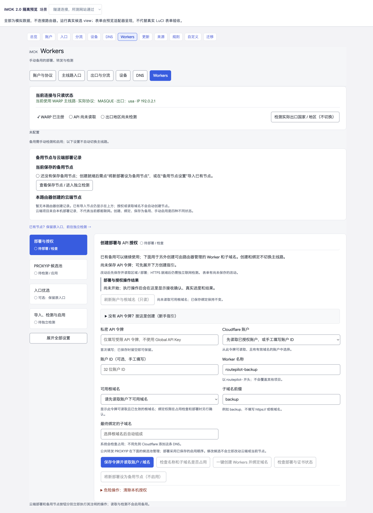

# iMOK 2.0

**把 Cloudflare WARP、设备分流、DNS 和规则更新，整理成一个清晰的路由器控制台。**

面向 OpenWrt / LuCI 的网络管理插件：在路由器集中管理主线路与手动备用，按设备或 LAN 选择接管范围，区分配置、连接和检测结果，让日常使用与排障都有据可查。

[**下载正式版 v0.2.35-6**](https://github.com/routepilot-lab/imok/releases/tag/v0.2.35-6) · [安装与升级](packages/luci-app-routepilot/INSTALL.zh-CN.md) · [使用指南](packages/luci-app-routepilot/README.zh-CN.md) · [常见问题](docs/FAQ.md) · [更新记录](CHANGELOG.md)

OpenWrt / LuCI network management with **Cloudflare WARP / MASQUE**, per-device and LAN policies, DNS diagnostics, persistent personal rules, and a manually enabled Workers backup.

## 一个入口，看清自己的网络

- **终端共享路由器策略。** 为选定设备或整个 LAN 管理受支持的 IPv4 流量，减少逐台维护配置的工作。
- **入口与出口各司其职。** 管理连接 Cloudflare 的入口，再从账户已有虚拟网络选择出口；实际 IP 和地区通过观测确认。
- **连接和可用性分开呈现。** 启用、配置应用、隧道连接、实际出口和网站检测分别展示，不用一个“正常”掩盖不同状态。
- **规则由你维护。** 选择或编辑来源、设置更新间隔；搜索订阅内容，添加个人规则或长期排除条目，订阅更新保留个人覆盖。
- **备用线路由你决定。** Workers 的部署、PROXYIP、入口优选和独立检测按阶段组织，检测后再手动启用。

## 界面一览

**总览：** 当前连接与接管范围、代理 / 直连流量、上传下载、七日趋势及出口目录，在一页清晰呈现。


**Workers：** 用阶段导航整理部署授权、PROXYIP、入口优选及导入检测，操作结果保留，复杂设置更容易找到。



> 上述为真实前端在隔离预览中的截图，使用模拟账户、示例 IP 和流量。用于展示界面，不代表某条线路的速度或真实账户配置。

## 完整的 12 个页面

| 主入口 | 页面与能力 |
| --- | --- |
| 总览 | 独立开关、真实连接、实际出口、接管范围、流量与七日趋势、连接记录 |
| Cloudflare 配置中心 | 账户与协议、主线路入口、出口与分流、设备、DNS、Workers 六个独立页面 |
| 规则与更新 | 更新概况、来源与频率、规则管理、自定义分流四个独立页面 |
| 备份迁移 | 导出 / 导入插件设置，保留 v2 / v3 兼容与原有恢复行为 |

iMOK 2.0 将全部页面、表单、按钮、状态、表格和弹窗统一为克制的浅色设计。字体来源继承 Argon，字号、行高、间距及控件由插件设计系统统一管理；样式限定在插件范围，不改动 LuCI 全局主题。

### 主线路与设备分流

管理 WARP / MASQUE 主线路，按设备或 LAN 接管，支持国内 IP 直连、全部代理、代理名单、直连名单等现有模式。一个主客户端同时共用一个出口；VPS 出口需要先在 Cloudflare 组织端部署好路由。

主线路入口支持官方自动、固定候选、手写 IPv4；定期同步读取客户端本地候选，不自动测速或换线。应用入口时才会重连、验证原预期出口；失败尝试恢复，不能确认时保留恢复保护和证据。

### DNS 与诊断

配置国内 / 代理上游，查看缓存，执行 DNS 解析与网站连通性检测。保留真实时间、历史标记和错误原因，区分隧道建立与目标网站可达。

### 规则与个人覆盖

来源地址可以选择预设，也可以编辑 HTTPS 地址；当前更新频率和执行计划清晰可见。规则支持分类、搜索、分页、个人新增、长期排除、候选确认与订阅版本回退。实际分类规则为“订阅减去排除，再加个人新增”，普通订阅更新及回退保留个人覆盖。

“始终直连 / 始终代理”在自定义分流页单独维护。当前普通设置导出不包含个人新增和排除，跨设备迁移需另行备份个人覆盖。

### Workers 手动备用

保留私人节点导入、API 授权、账户 / 域名 / 项目选择、名称检查、部署与证书状态、PROXYIP 管理与检测、入口优选、手动启用 / 切回主线和清除授权。部署、检测和线路可用是不同状态。备用支持 IPv4 TCP，不自动故障切换。

## 下载、安装与升级

当前正式发布：**v0.2.35-6 · iMOK 2.0 完整界面版**。2.0 表示本轮 UI/UX 体系，插件包继续使用兼容版本号 `0.2.35-6`。

[Release 下载页](https://github.com/routepilot-lab/imok/releases/tag/v0.2.35-6) 提供：

| 文件 | 用途 |
| --- | --- |
| `luci-app-routepilot_0.2.35-6_all.ipk` | 已有兼容运行环境的插件升级包 |
| `imok-0.2.35-6-public-source.zip` | 本版公开源码、文档、界面示例及许可 |
| `SHA256SUMS` | 安装包和源码包的 SHA-256 校验值 |

**这不是路由器固件，也不是完整首次安装包。** 公开包不含 Cloudflare 客户端、Debian 运行环境、注册身份、Token 或私人节点。新设备需要自行合法准备运行环境和当前固件匹配的依赖，先阅读[安装说明](packages/luci-app-routepilot/INSTALL.zh-CN.md)。

已有环境的设备：先备份配置、身份和个人规则，保存原版本 IPK；核对校验值后安装新 IPK，刷新 LuCI 页面并检查原入口、出口、接管范围和联网情况。升级会短暂重连。不要卸载旧包、重注册或覆盖运行环境来完成普通升级。

项目原名 RoutePilot。包名 `luci-app-routepilot`，以及 UCI、服务、目录和接口继续使用 `routepilot`，以保留已有配置和身份。历史版本和下载继续保留。

## 本版验证

2026-11-08，v0.2.35-6 已部署至维护者的 **GL.iNet GL-MT6000 / ARM64 / OpenWrt 24.10 / Argon 2.2.9.4** 环境，维护者确认本轮完整界面和使用体验满意。

- 380 项 Python 测试、13 组前端测试、目标 LuCI 模块契约、资源哈希和可复现构建通过。
- 真机 12 页加载新资源；规则动态数据加载完成后，已修复的 `null` / `undefined` 显示未再出现。
- 安装后核对 44 个非配置程序文件，98 个受保护文件哈希一致，原身份、配置、入口、出口和个人规则保留。
- 安装后连续状态采样稳定，代理 Google / Cloudflare 和直连百度 HTTPS 通过；升级前的 UI 验收另完成 DNS 与五站检测。

桌面体验优先。真实 Windows / Safari / 移动系统、其他机型、全新环境安装、WireGuard 切换和多 LAN 端到端验证不在本轮通过范围；小屏在主题侧栏展开时仍需注意可用宽度。具体证据与限制见[本版检查摘要](docs/PUBLICATION_CHECKS.json)。

插件不改写既有 SSR 或系统 network / firewall / dhcp 配置文件，但启用后会维护自己的运行时路由、nft、命名空间和 DNS 接管。主线路故障撤回接管时可能宽带直连；IPv6 可阻断或明确允许直连，不提供 IPv6 代理。请按自己的需求选择策略。

## 构建与检查

使用 Python 3、Node.js 和系统工具，无大型前端框架，无远程字体依赖。

```sh
python3 packages/luci-app-routepilot/tools/asset_versions.py --check
python3 packages/luci-app-routepilot/tools/build.py
python3 packages/luci-app-routepilot/tools/check_all.py --luci-core /path/to/target/luci.js --report .local/check-all/report.json
```

Makefile 是版本来源。完整检查需自行取得目标 LuCI 核心文件，不分发设备文件，也不用替身冒充真实 ABI 检查。发布流程仅在安装包与已验收 SHA-256 一致后创建正式 Release。

## English overview

iMOK 2.0 brings a consistent, native LuCI interface to Cloudflare WARP / MASQUE routing: clear connection and exit status, per-device or LAN policies, DNS diagnostics, editable rule sources, persistent personal additions / exclusions, and a manually enabled Workers backup. All 12 pages share scoped styling and Argon typography.

**v0.2.35-6 is the current regular release**, deployed and checked on the maintainer’s GL-MT6000 / ARM64 OpenWrt 24.10 router. UI screenshots use synthetic data. The IPK updates an existing compatible runtime; it is not firmware or a complete first-install image. Other hardware, real mobile browsers, WireGuard switching and multi-LAN end-to-end behavior have not been fully validated. Entry selection does not determine exit country. Workers backup requires independent testing and manual activation.

## 反馈与参与

欢迎通过 [Issues](https://github.com/routepilot-lab/imok/issues/new/choose) 提交版本、硬件、固件、复现步骤及脱敏错误。请勿上传 Token、登录链接、私钥或完整设备配置。若项目对你有帮助，欢迎 Star 或分享给有相同需求的人。

## 项目初衷与感谢 / Acknowledgements

imok 从一个真实的需求开始：让大陆用户在兼容路由器上，更方便地管理访问开放互联网的连接，同时兼顾日常直连、速度体验和可控性。项目由维护者持续提出需求、亲自试用和反馈，并与 AI 工具一起反复开发、检查与改进，逐步走到公开发布。我们希望这些工作能帮助更多有相同需求的人。

首先感谢 **[Cloudflare](https://www.cloudflare.com/)**。WARP、Zero Trust 和 Workers 为这个项目提供了关键的服务与技术基础；imok 在这些能力之上，把路由器侧的管理、分流和诊断整理为可操作的界面。

感谢 **[ChatGPT / OpenAI](https://openai.com/chatgpt/)**，在需求梳理、技术研究、代码开发、测试、排障和文档整理中参与协作，让一个想法逐步成为可以使用、检查和分享的项目。

感谢 **[Claude Opus / Anthropic](https://www.anthropic.com/claude)**，在关键方案与代码差异的独立技术审查中提供另一份判断，帮助我们发现遗漏、核对边界并改进实现。独立静态审查与实际运行验证各有职责，相关验证范围记录在项目文档中。

也感谢 **OpenWrt、LuCI、cmliu/edgetunnel 及相关开源贡献者**，以及每一位愿意试用、反馈和完善项目的人。项目的进步来自这些基础与协作，也来自维护者坚持把真实问题一个个解决。

我们对更广泛可用性的期待是项目愿景；实际速度和可用性仍取决于运营商、网络环境、Cloudflare 服务、所选出口及硬件，不能将当前测试结果视为对所有地区、所有用户或固定带宽的保证。

**English:** Our thanks go first to Cloudflare for the WARP, Zero Trust and Workers foundations; to ChatGPT / OpenAI for development collaboration; to Claude Opus / Anthropic for independent technical review; and to the OpenWrt, LuCI and upstream open-source communities. imok is a community project, independently maintained and not an official product or endorsement of these organizations.

## 许可

imok 自有代码为 MIT，内置 cmliu/edgetunnel 衍生 Worker 为 GPL-2.0，保留对应源码、许可及来源。第三方客户端和服务按各自条款使用。参见[第三方说明](THIRD_PARTY_NOTICES.txt)。本项目不是 Cloudflare 官方产品。
