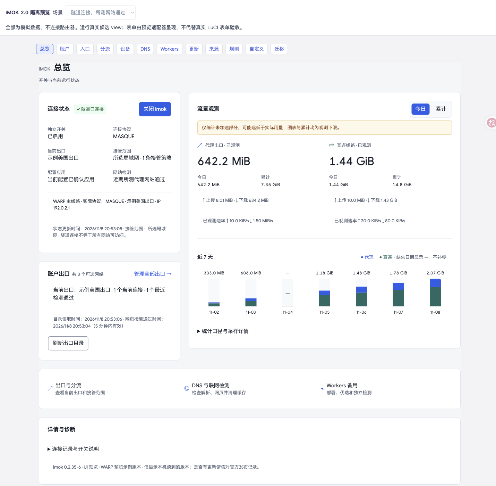
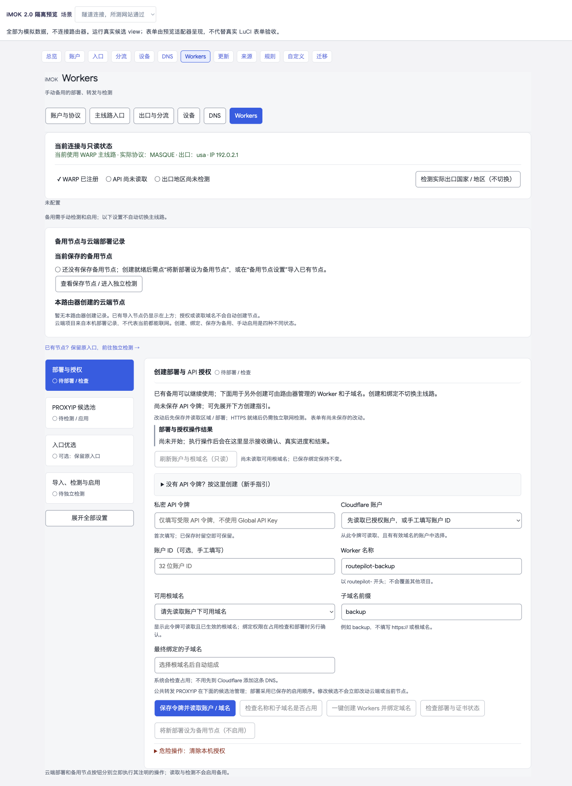

# iMOK 2.0 · 完整界面版

<!-- release-status: stable -->

本版完成 12 个页面与公共交互的统一重构，并在现有路由器部署验证后正式发布。沿用原生 LuCI 与 Argon 字体来源；保留既有配置、接口和网络行为。

## 本版亮点

- 总览集中显示启用、真实隧道、实际出口与接管范围，重做代理 / 直连流量及七日趋势。
- 账户、入口、分流、设备与 DNS 采用一致表单和设置分组；Workers 通过四个阶段组织复杂操作。
- 规则分为更新概况、来源与频率、规则管理、自定义分流；可编辑来源，维护长期保留的个人新增和排除。
- 统一导航选中态、按钮、表格、弹窗、加载与错误反馈，保留危险操作确认。
- 修复真机 Argon 原生按钮对比度，以及三个规则页面的 6 处空值文字；预览与回归测试已按目标 LuCI 行为校准。

截图使用模拟数据，不包含真实账户或私有配置。

## 下载与升级

- `luci-app-routepilot_0.2.35-6_all.ipk`：已有兼容运行环境的插件升级包。
- `imok-0.2.35-6-public-source.zip`：公开源码、文档、截图与许可。
- `SHA256SUMS`：附件校验值。

已有设备先保留旧 IPK，并独立备份身份、配置及个人规则，核对校验值后升级。普通 opkg 安装会短暂重连；保留已有身份和运行环境，刷新页面后核对原入口、出口、接管范围及联网情况。包名与技术路径保留 routepilot 以兼容旧版。

公开包不是固件或完整首次安装包，不包含 Cloudflare 客户端、Debian 运行环境、身份、Token 或私人节点。全新设备须自行合法准备运行环境与固件依赖。普通设置导出尚不包含个人新增 / 排除，迁移需另备份。

## 验证与边界

380 项 Python、13 组 JavaScript、目标 LuCI 模块契约、资源哈希与可复现构建通过。GL-MT6000 / ARM64 / OpenWrt 24.10 / Argon 2.2.9.4 已实际安装本版，44 个程序文件匹配，98 个受保护文件保持；原线路、个人规则、配置与身份保留，代理及直连 HTTPS 检查通过。维护者确认界面和体验满意。

桌面优先；真实跨系统移动浏览器、其他机型、全新安装、WireGuard 切换及多 LAN 端到端未完成全面验收。Workers 只支持 IPv4 TCP，检测后手动启用，不自动切换。连接成功不等于所有网站可达，入口 IP 不决定出口地区；故障撤回接管时可能宽带直连。

自有代码 MIT；内置 cmliu/edgetunnel 衍生 Worker 保留 GPL-2.0、对应源码和来源。不是 Cloudflare 官方产品。
